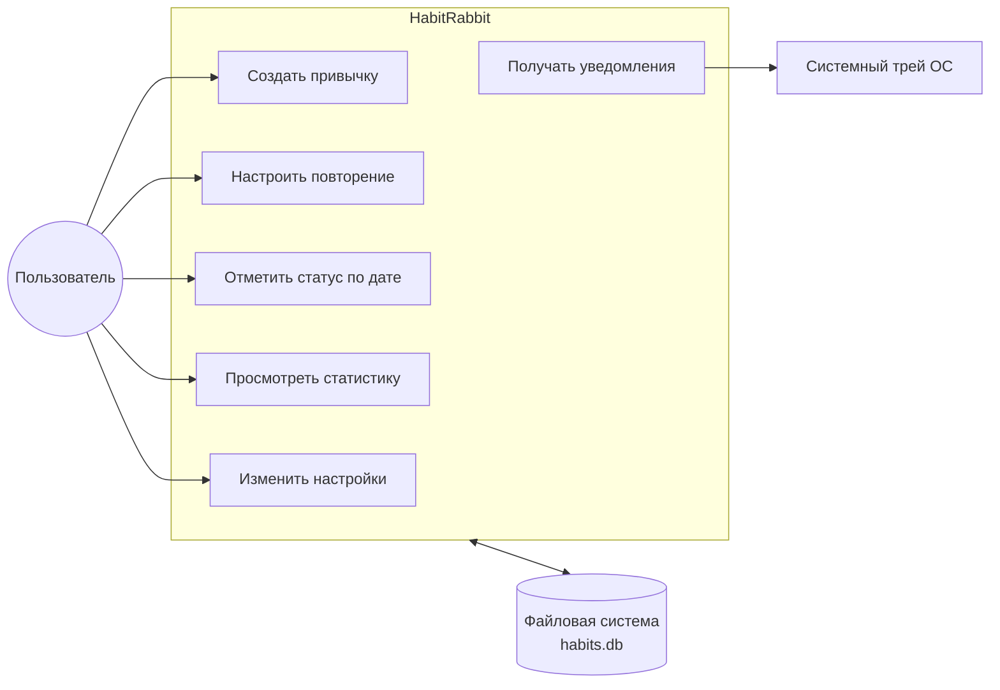
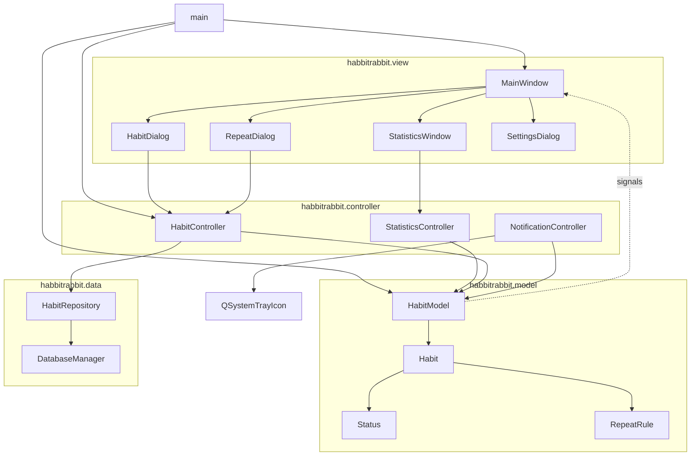
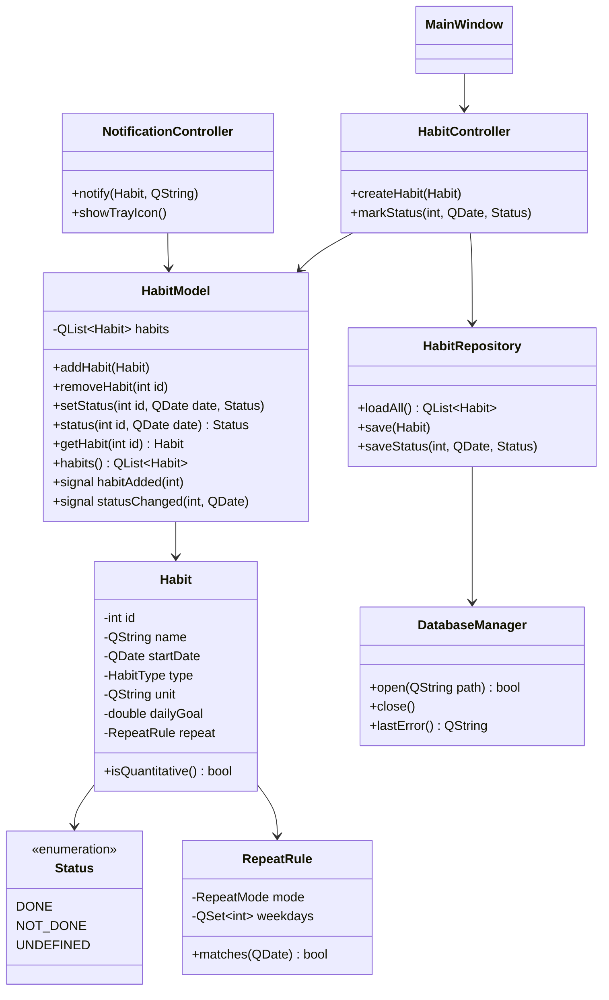
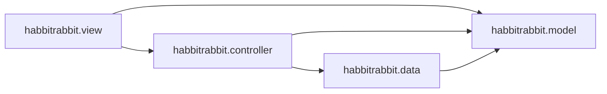
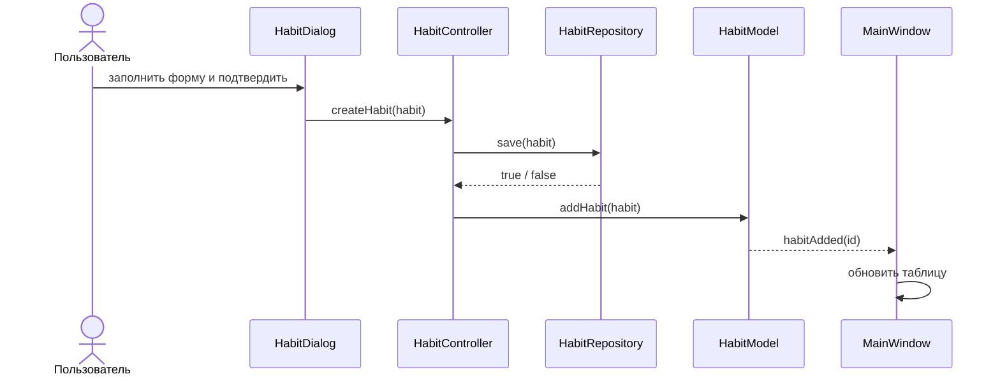
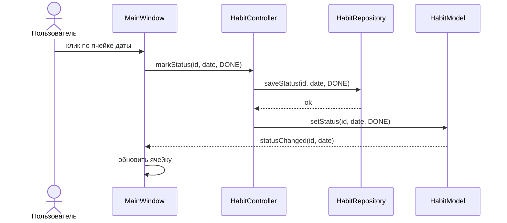
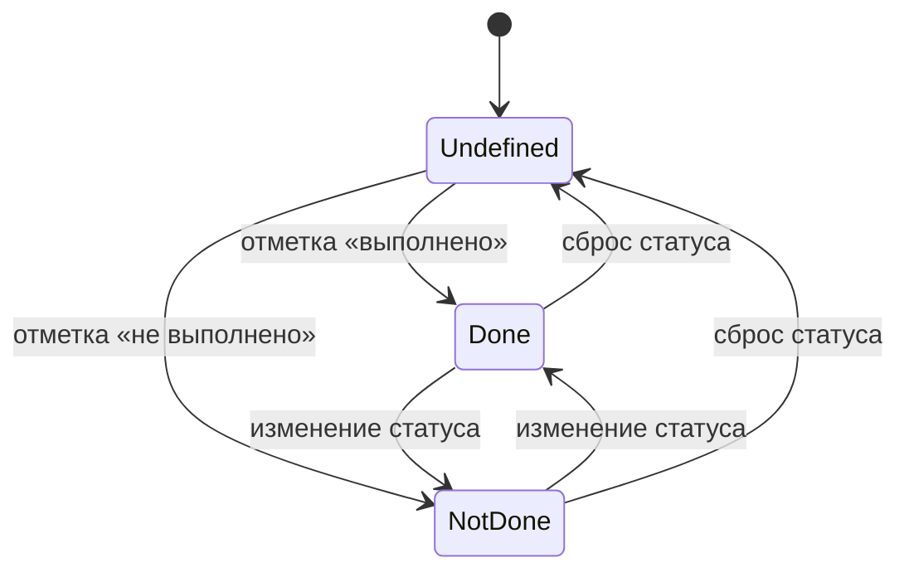
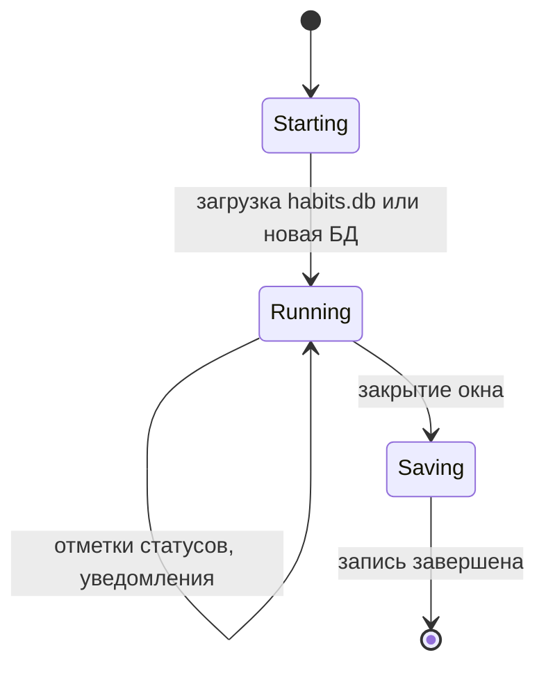
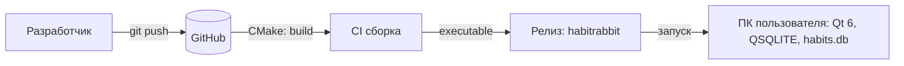

# Описание дизайна программного обеспечения

Для HabitRabbit

Версия 0.1

Подготовил(а) _Савонов Алексей Иванович_

БГУИР, кафедра ЭВМ

_25.10.2026_

## Оглавление

* [1. Введение](#1-introduction)
* [2. Обзор дизайна](#2-design-overview)
* [3. Проектные представления](#3-design-views)
* [4. Решения](#4-decisions)
* [5. Приложения](#5-appendixes)

## История изменений

| Name | Date | Reason For Changes | Version |
|------|------|--------------------|---------|
| Савонов А.И. | 2026-10-25 | Первая версия SDD на основе SRS v1.2 | 0.1 |

---

## 1. Введение {#1-introduction}

### 1.1 Назначение документа {#11-document-purpose}

Документ описывает проектные решения десктопного приложения HabitRabbit: состав компонентов, их взаимодействие, данные и принятые архитектурные решения. Он предназначен разработчикам (реализация и сопровождение), преподавателю (оценка процесса) и Заказчику (понимание, из чего состоит продукт). Документ вытекает из спецификации требований ([srs/srs.md](../srs/srs.md)).

### 1.2 Область применения {#12-subject-scope}

Проектируется HabitRabbit версии 0.x: однопользовательское офлайн-приложение для Windows, Linux и macOS на C++20 с Qt 6 Widgets. Пользователь создаёт привычки (единовременные или количественные), настраивает повторение, отмечает статусы по датам, просматривает статистику и получает уведомления через системный трей; данные хранятся локально в SQLite.

Входит: игровая логика привычек, графический интерфейс, локальное хранение в `habits.db`, статистика с графиками, уведомления системного трея, сборка и тесты.
Не входит: сетевые функции, учётные записи, серверная база данных, мобильные и веб-версии, функции ИИ/МО.

### 1.3 Определения, акронимы и сокращения {#13-definitions-acronyms-and-abbreviations}

| Term | Definition |
|------|------------|
| ADR | Architecture Decision Record — запись архитектурного решения |
| GUI | Graphical User Interface — графический пользовательский интерфейс |
| MVC | Model-View-Controller — разделение на модель, представление и контроллер |
| SDD | Software Design Document — документ описания проектирования |
| SRS | Software Requirements Specification — спецификация требований |
| SQLite | Локальная база данных, подключаемая через Qt SQL |
| Системный трей | Область уведомлений рабочего стола (значок и всплывающие сообщения) |
| Количественная привычка | Привычка с единицами измерения и дневной целью |
| Единовременная привычка | Привычка без количественной цели |

### 1.4 Ссылки {#14-references}

| Документ | Тип | Расположение |
|---|---|---|
| Спецификация требований (SRS) | нормативный | `srs/srs.md` |
| Структурная модель интерфейса на SysML v2 | справочный | `srs/ui-model.sysml` |
| Мокапы интерфейса | справочный | `srs/img/mockup-*.png` |
| Протоколы архитектурных решений | нормативный | `adr/` |
| Репозиторий проекта | справочный | https://github.com/SavaleOx/SDLC |

### 1.5 Обзор документа {#15-document-overview}

Раздел 2 определяет стейкхолдеров и выбранные точки зрения. Раздел 3 содержит проектные представления (идентификаторы вида `001-context`) со ссылками на требования и решения. Раздел 4 перечисляет решения, подробности — в `adr/`. Раздел 5 — приложения. Документ ведётся в Git; каждое изменение отражается в истории изменений.

---

## 2. Обзор дизайна {#2-design-overview}

### 2.1 Задачи стейкхолдеров {#21-stakeholder-concerns}

| Стейкхолдер | Основные задачи | Точки зрения / представления |
|---|---|---|
| Пользователь | Удобно создавать привычки, видеть историю, получать напоминания, не терять данные | Context, Interaction, State dynamics, Information |
| Заказчик | Соблюдение сроков, предсказуемый объём, соответствие SRS | Composition, Resources, Patterns |
| Разработчик | Простота изменения, тестируемость, расширяемость | Logical, Dependency, Interface, Patterns, Algorithm |
| Тестировщик | Возможность проверять логику без интерфейса | Logical, Interface, Algorithm |
| Преподаватель | Прослеживаемость требований → дизайн → решения | Все представления, раздел 4 |

### 2.2 Выбранные точки зрения {#22-selected-viewpoints}

Используются UML-диаграммы в нотации Mermaid (отображаются в GitHub) и таблицы.

#### 2.2.1 Контекст {#221-context}
Выбрана: определяет границы и акторов. Язык: диаграмма вариантов использования. Адресует: Пользователя, Заказчика.

#### 2.2.2 Композиция {#222-composition}
Выбрана: показывает разбиение на пакеты MVC и внешние зависимости. Язык: диаграмма компонентов. Адресует: Заказчика, разработчика.

#### 2.2.3 Логическое представление {#223-logical}
Выбрана: статическая структура классов. Язык: диаграмма классов UML. Адресует: разработчика, тестировщика.

#### 2.2.4 Физическое представление {#224-physical}
Не используется: продукт работает на обычном ПК пользователя, специальной аппаратной инфраструктуры нет.

#### 2.2.5 Структура {#225-structure}
Отдельное представление не выбрано: внутренняя организация подсистем показана в 002-composition и 003-logical, коннекторы MVC — в 011-patterns.

#### 2.2.6 Зависимости {#226-dependency}
Выбрана: контроль связанности пакетов. Язык: диаграмма пакетов. Адресует: разработчика.

#### 2.2.7 Информация {#227-information}
Выбрана: структура сохраняемых данных. Язык: таблица схемы. Адресует: пользователя (сохранность), разработчика.

#### 2.2.8 Интерфейс {#228-interface}
Выбрана: контракты публичных классов. Язык: сигнатуры методов. Адресует: разработчика, тестировщика.

#### 2.2.9 Взаимодействие {#229-interaction}
Выбрана: порядок сообщений в сценариях «создание привычки», «отметка статуса», «сохранение». Язык: диаграммы последовательности. Адресует: разработчика, пользователя.

#### 2.2.10 Алгоритм {#2210-algorithm}
Выбрана: формулы статистики и расчёта прогресса. Язык: математическая запись и псевдокод. Адресует: разработчика, тестировщика.

#### 2.2.11 Динамика состояний {#2211-state-dynamics}
Выбрана: состояния статуса привычки и жизненный цикл приложения. Язык: диаграмма конечных автоматов. Адресует: разработчика, пользователя.

#### 2.2.12 Параллелизм {#2212-concurrency}
Выбрана: политика потоков (интерфейс и работа с БД в главном потоке Qt). Язык: таблица. Адресует: разработчика.

#### 2.2.13 Паттерны {#2213-patterns}
Выбрана: MVC, Observer (сигналы/слоты Qt), перечисления с поведением. Язык: таблица. Адресует: разработчика, Заказчика.

#### 2.2.14 Развёртывание {#2214-deployment}
Выбрана: сборка CMake и запуск исполняемого файла на целевой ОС. Язык: диаграмма развёртывания. Адресует: Заказчика, пользователя.

#### 2.2.15 Ресурсы {#2215-resources}
Выбрана: память, файловая система, таймеры. Язык: таблица. Адресует: Заказчика, разработчика.

---

## 3. Проектные представления {#3-design-views}

### 001-context

- **Title**: Контекст системы
- **Viewpoint**: Context
- **Реализует требования**: REQ-INT-001…REQ-INT-006, REQ-AVAIL-001, REQ-AVAIL-002
- **Решения**: [ADR-0001](../adr/0001-cpp-qt-desktop.md)



Единственные внешние взаимодействия — локальная файловая система (SQLite) и системный трей ОС. Сетевых взаимодействий нет.

### 002-composition

- **Title**: Состав системы
- **Viewpoint**: Composition
- **Реализует требования**: REQ-MAINT-001, REQ-MAINT-002, REQ-MAINT-003, REQ-PORT-001
- **Решения**: [ADR-0002](../adr/0002-mvc-active-model-observer.md)



Внешние зависимости: Qt 6 (Widgets, Core, Gui, Sql, Multimedia), драйвер QSQLITE, JKQTPlotter6. Компонент `NotificationController` изолирует логику уведомлений от хранения и статистики (REQ-MAINT-003).

### 003-logical

- **Title**: Логическая структура классов
- **Viewpoint**: Logical
- **Реализует требования**: REQ-FUNC-001…REQ-FUNC-015
- **Решения**: [ADR-0002](../adr/0002-mvc-active-model-observer.md)



### 004-dependency

- **Title**: Зависимости пакетов
- **Viewpoint**: Dependency
- **Реализует требования**: REQ-MAINT-001



Правило: пакет `habbitrabbit.model` не импортирует `QWidget`, `habbitrabbit.view` и `habbitrabbit.controller`; проверяется при ревью и тестами модели без GUI. `NotificationController` не обращается к `DatabaseManager` напрямую.

### 005-information

- **Title**: Данные сохранения
- **Viewpoint**: Information
- **Реализует требования**: REQ-FUNC-010, REQ-FUNC-011, REQ-REL-001, REQ-SEC-001
- **Решения**: [ADR-0003](../adr/0003-sqlite-persistence.md)

Файл `habits.db` (SQLite, драйвер QSQLITE). Схема:

| Таблица | Поле | Тип | Смысл |
|---|---|---|---|
| `habits` | `id` | INTEGER PK | идентификатор привычки |
| `habits` | `name` | TEXT NOT NULL | название |
| `habits` | `start_date` | TEXT (ISO) | дата начала |
| `habits` | `type` | INTEGER | 0 — единовременная, 1 — количественная |
| `habits` | `unit` | TEXT NULL | единицы измерения (для количественной) |
| `habits` | `daily_goal` | REAL NULL | дневная цель (для количественной) |
| `habits` | `repeat_mode` | INTEGER | 0 — ежедневно, 1 — пользовательское |
| `habits` | `repeat_weekdays` | TEXT NULL | дни недели для пользовательского повторения |
| `statuses` | `habit_id` | INTEGER FK | ссылка на привычку |
| `statuses` | `date` | TEXT (ISO) | дата статуса |
| `statuses` | `value` | INTEGER | 0 — не выполнено, 1 — выполнено, NULL — отсутствует |

Целостность: при открытии БД проверяется схема; при ошибке чтения/записи приложение не сообщает об успешной операции (REQ-SEC-001).

### 006-interface

- **Title**: Публичные интерфейсы ключевых классов
- **Viewpoint**: Interface
- **Реализует требования**: REQ-FUNC-001…REQ-FUNC-015, REQ-INT-006

| Класс | Метод | Контракт |
|---|---|---|
| `HabitModel` | `addHabit(Habit)` | добавляет привычку, испускает `habitAdded` |
| `HabitModel` | `setStatus(int, QDate, Status)` | сохраняет статус, испускает `statusChanged` |
| `HabitRepository` | `loadAll()` | возвращает все привычки; при ошибке — пустой список и диагностика |
| `HabitRepository` | `save(Habit)` | сохраняет привычку; возвращает `bool`, ошибка доступна через `lastError()` |
| `HabitController` | `createHabit(Habit)` | валидирует и сохраняет привычку через репозиторий |
| `NotificationController` | `notify(Habit, QString)` | показывает уведомление в трее; при отсутствии трея — без критической ошибки |
| `NotificationController` | `showTrayIcon()` | отображает значок приложения в трее, если он поддерживается |

### 007-interaction

- **Title**: Сценарии взаимодействия
- **Viewpoint**: Interaction
- **Реализует требования**: REQ-FUNC-001, REQ-FUNC-006, REQ-FUNC-008, REQ-INT-006

Сценарий «создание привычки»:



Сценарий «отметка статуса»:



Сценарий «уведомление»: `NotificationController` по таймеру проверяет привычки с наступившим повторением и вызывает `notify()`; при отсутствии системного трея вызов завершается без критической ошибки (REQ-AVAIL-002).

### 008-algorithm

- **Title**: Игровые формулы и алгоритмы
- **Viewpoint**: Algorithm
- **Реализует требования**: REQ-FUNC-013, REQ-FUNC-014

| Величина | Формула |
|---|---|
| Доля выполнения за период | `done / expected`, где `expected` — число дат по правилу повторения |
| Относительный результат | `current / max` по выбранному периоду |
| Прогресс количественной привычки | `min(value / dailyGoal, 1)` |

Псевдокод расчёта серии:
```
streak = 0
for date from today backwards:
    if status(date) == DONE: streak++
    else if repeat.matches(date): break
```
Все операции линейны по числу дат в выбранном периоде; параметры периода вынесены в настройки графика.

### 009-state-dynamics

- **Title**: Динамика состояний
- **Viewpoint**: State dynamics
- **Реализует требования**: REQ-FUNC-008, REQ-FUNC-011





### 010-concurrency

- **Title**: Политика потоков
- **Viewpoint**: Concurrency
- **Реализует требования**: REQ-PERF-001, REQ-PERF-002
- **Решения**: [ADR-0004](../adr/0004-single-thread-qt.md)

| Активность | Поток | Механизм |
|---|---|---|
| Интерфейс, клики, диалоги | главный поток Qt | события Qt |
| Работа с SQLite | главный поток Qt | QSqlDatabase |
| Уведомления трея | главный поток Qt | QSystemTrayIcon |
| Таймер проверки напоминаний | главный поток Qt | QTimer |

Допущение: объём данных типичного пользователя невелик, поэтому операции с БД не блокируют интерфейс заметно. При росте данных операции чтения выносятся в отдельный поток (см. ADR-0004).

### 011-patterns

- **Title**: Применённые паттерны
- **Viewpoint**: Patterns

| Паттерн | Где | Зачем |
|---|---|---|
| MVC | `model` / `view` / `controller` | разделение логики и интерфейса |
| Observer | сигналы/слоты Qt (`HabitModel` → `MainWindow`) | обновление интерфейса без связи модели с GUI |
| Repository | `HabitRepository` | изоляция SQL от логики |
| Enum with behavior | `Status`, `RepeatMode` | расширение без изменения ядра |
| Facade | `NotificationController` | единая точка уведомлений |

### 012-deployment

- **Title**: Развёртывание
- **Viewpoint**: Deployment
- **Реализует требования**: REQ-BUILD-001, REQ-PORT-001, REQ-PORT-002
- **Решения**: [ADR-0001](../adr/0001-cpp-qt-desktop.md)



Запуск: исполняемый файл, собранный CMake. Установщик не требуется; уведомления зависят от поддержки системного трея средой рабочего стола.

### 013-resources

- **Title**: Использование ресурсов
- **Viewpoint**: Resources
- **Реализует требования**: REQ-PERF-001, REQ-PERF-002

| Ресурс | Оценка / ограничение |
|---|---|
| Память | ожидается менее 150 МБ (оценка, подлежит замеру) |
| Диск | файл `habits.db` менее 1 МБ при типичном объёме; запись при изменении статуса |
| ЦПУ | таймер напоминаний, обновление таблицы; нагрузка пренебрежимо мала |
| Таймеры | 1 (`QTimer` проверки напоминаний) |
| Запуск | не более 3 с (SC-3) |

---

## 4. Решения {#4-decisions}

| ID | Название | Статус |
|---|---|---|
| ADR-0001 | [C++20 и Qt 6 Widgets для десктопного клиента](../adr/0001-cpp-qt-desktop.md) | принято |
| ADR-0002 | [MVC с активной моделью и сигналами/слотами Qt](../adr/0002-mvc-active-model-observer.md) | принято |
| ADR-0003 | [Локальное сохранение в SQLite через QSQLITE](../adr/0003-sqlite-persistence.md) | принято |
| ADR-0004 | [Однопоточная работа с БД и интерфейсом в главном потоке Qt](../adr/0004-single-thread-qt.md) | принято |
| ADR-0005 | [Уведомления через системный трей с деградацией без трея](../adr/0005-system-tray-notifications.md) | принято |

---

## 5. Приложения {#5-appendixes}

- Структурная модель интерфейса на SysML v2: [`srs/ui-model.sysml`](../srs/ui-model.sysml)
- Мокапы интерфейса: `srs/img/mockup-*.png`
- Типы привычек и правила повторения: `src/model/Habit.h`, `RepeatRule.h`
- Трассировка требований к представлениям и решениям: таблица в `srs/srs.md` (раздел 4)

